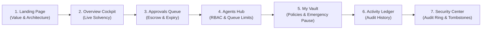

# Vault Shield — Judge Demo Walkthrough

**Project**: Vault Shield — NEAR AI Agent Vault  
**Live URL**: [https://vault-shield-two.vercel.app](https://vault-shield-two.vercel.app)  
**Contract ID**: `contract.vault-parent.testnet`  
**Network**: NEAR Public Testnet  
**Author**: MendezBuilds  

---

## 🎯 Overview

Vault Shield is a non-custodial, policy-governed smart contract vault built on the NEAR blockchain. It empowers autonomous AI agents to initiate on-chain transactions, pay API providers, and execute smart contracts while strictly guaranteeing that agents can never drain funds, exceed spending caps, or front-run storage reserves.

This guide provides hackathon judges with a step-by-step walkthrough of the live production application across its **7 core modules**.

---

## 🚀 Demonstration Flow

---

### Step 1: The Landing Page (`/`)
1. Navigate to [https://vault-shield-two.vercel.app](https://vault-shield-two.vercel.app).
2. **Hero Section**: Highlights the core value proposition: *"Give AI Agents the Power to Act. Never the Power to Spend Freely."*
3. **Problem Statement**: Details how autonomous agents with raw private keys risk total balance liquidation through prompt injection, hallucinated transactions, and runaway API loops.
4. **Architectural Solution**: Interactive breakdown of reservation accounting, dual-tier queue limiting, storage reserve preservation, and policy enforcement.
5. **Call to Action**: Click **"Launch App"** or navigate directly to `/#app`.

---

### Step 2: Overview Security Cockpit (`/#app`)
1. **Solvency Metric Cards**:
   - **Total Account Balance**: Reflects live on-chain NEAR balance (`~5.196 NEAR`).
   - **Storage Reserve Requirement**: Live dynamic storage calculation (`4.947 NEAR`). Guaranteed rent preservation.
   - **Protected Balance**: Total balance minus storage reserve (`0.248 NEAR`).
   - **Pending Reserved**: Funds currently locked in escrow for queued requests (`0.100 NEAR`).
   - **Available Liquid Balance**: Strictly unencumbered funds available for immediate agent spending (`0.148 NEAR`).
2. **Daily Spend Gauge**: Real-time progress bar tracking the current 24-hour UTC bucket against the `2.0 NEAR` daily ceiling.
3. **Queue Status Indicator**: Shows Global Queue occupancy (`1 / 32 Slots`).

---

### Step 3: Approvals Queue (`/#app` → Approvals)
1. **Pending Request #2 Inspection**:
   - **Agent**: `agent-a.vault-parent.testnet`
   - **Destination**: `unlisted.vault-parent.testnet`
   - **Amount**: `0.100 NEAR`
   - **Origin Reason Badge**: `NewDestinationOnly` — Demonstrates policy precision: although the amount (0.100 NEAR) was under the auto-approval threshold (0.200 NEAR), the contract flagged the destination as unlisted and held it for human-in-the-loop owner approval.
   - **TTL & Expiry**: Over 46 hours have elapsed since creation. The badge reflects `EXPIRED`.
2. **Action Controls**:
   - Demonstrates owner authority: Approve, Reject, or trigger permissionless `Expire` to return reserved funds to the liquid pool.

---

### Step 4: Agents Management Hub (`/#app` → Agents)
1. **Authorized Agent List**:
   - `agent-a.vault-parent.testnet`: Status **Active**. Demonstrates real-time tracking of agent pending counts (`1 / 2 Slots`).
   - `agent-rev.vault-parent.testnet`: Status **Revoked**. Shows historical revocation proof on-chain.
2. **Dual-Tier Queue Guard**:
   - Explain the queue architecture: while the contract supports 32 global pending requests, each individual agent is hard-capped at 2 pending slots (`MAX_AGENT_PENDING = 2`). This stops rogue agents from flooding the vault.
3. **Agent Registration**:
   - Modal allows registering new agent account IDs with explicit owner authorization.

---

### Step 5: Vault Policy & Emergency Controls (`/#app` → My Vault)
1. **Policy Settings**:
   - **Max Per Transaction**: `1.0 NEAR`
   - **Daily Spending Cap**: `2.0 NEAR`
   - **Auto-Approval Threshold**: `0.2 NEAR`
2. **Destination Allowlist**:
   - Shows pre-approved merchants: `merchant.vault-parent.testnet`.
   - Adding or removing destinations dynamically updates the policy.
3. **Emergency Circuit Breaker**:
   - **Emergency Pause Toggle**: One-click freeze of all agent spending actions in the event of an detected exploit or anomaly.
4. **Liquid Withdrawal**:
   - Owner withdrawal modal bounded strictly by `available_liquid_balance`, preventing the owner from accidentally violating storage reserves.

---

### Step 6: Transaction Ledger (`/#app` → Activity)
1. **Full Transaction Lifecycle**:
   - Tabular history showing Auto-Approved payments, Manual Approvals, Denials, and Expirations.
   - Clear visual indicators of payment destination, agent ID, and yoctoNEAR precision.

---

### Step 7: Security Center & Cryptographic Audit (`/#app` → Security)
1. **On-Chain Circular Audit Ring (50 Slots)**:
   - Live query of the on-chain audit ring buffer (`get_audit_records`).
   - Records administrative events: `VaultPaused`, `DestinationAdded`, `AgentRegistered`, and security alerts (`PaymentPolicyDenied`).
2. **Stuck Request Reconciliation & Tombstone Attestation**:
   - Demonstrates the fault-recovery mechanism: if an agent request enters an indeterminate cross-contract state, the owner can invoke `reconcile_stuck_request` with an external transaction hash.
   - Produces an immutable, permanent `ReconciledTombstone` preventing double-execution.

---

## 🔒 Evaluation Persona Selector

In the top right navigation bar, click the **Wallet / Persona** button to simulate different operational perspectives:
- **Owner Mode (`owner.vault-parent.testnet`)**: Full administrative access to approve/reject requests, edit policies, and trigger pause.
- **Agent Alpha Mode (`agent-a.vault-parent.testnet`)**: Restricted agent perspective illustrating payment request submission.
- **Connect Real Wallet**: Seamless connection via NEAR Wallet Selector to MyNearWallet or Meteor for genuine live testnet transaction signing.

---

## 🔬 Final On-Chain Evidence Addendum

### On-Chain Request #2 Expiry Verification
- **Executed Transaction**: [`37oJPsbysoFLtzcUeKh1KZq4YEm14pxCepCzc5cz1Z54`](https://explorer.testnet.near.org/transactions/37oJPsbysoFLtzcUeKh1KZq4YEm14pxCepCzc5cz1Z54)
- **Signer**: `relayer.vault-parent.testnet`
- **Method**: `expire_request(2)`
- **Gas**: 3.5 Tgas consumed
- **Audit Ring Proof**: Sequence ID 38, Event `PaymentExpired`, Request ID 2, Timestamp `1794211966520387600`.
- **Accounting Verification**:
  - Pending reservation decreased from `0.100 NEAR` to `0.000 NEAR`.
  - Available liquid balance restored to `0.2489 NEAR`.
  - Global pending queue is at `0 / 32 Slots`.

### Policy Enforcement & Security Summary
- All 10 core policy scenarios verified via on-chain audit ring events and Stage 4 execution.
- Real transactions sign client-side via Wallet Selector.
- Serverless proxy `/api/tx/execute` blocks simulation attacks on production.
- Contract remains non-custodial and mathematically solvent.

