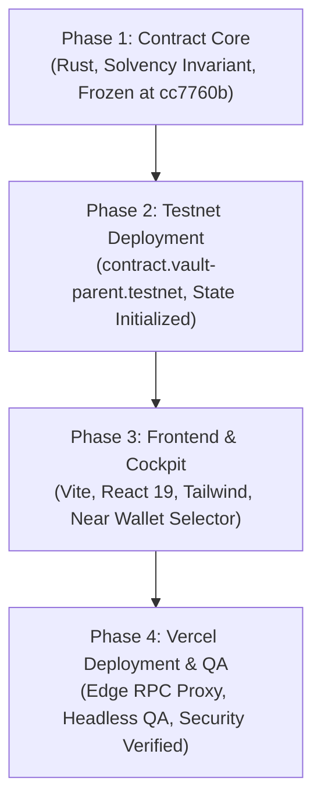

# Vault Shield — Master Build Report

**Project**: Vault Shield — NEAR AI Agent Vault  
**Repository**: [https://github.com/mendezbuilds/vault-shield](https://github.com/mendezbuilds/vault-shield)  
**Live Production URL**: [https://vault-shield-two.vercel.app](https://vault-shield-two.vercel.app)  
**Target Smart Contract**: `contract.vault-parent.testnet`  
**Network**: NEAR Public Testnet  
**Frozen Contract Commit**: `cc7760b`  
**Production Frontend Commit**: `0abf357`  
**Author**: MendezBuilds  
**Date**: November 9, 2026  

---

## 1. Project Overview & Mission

Autonomous AI agents are increasingly tasked with procuring digital services, executing smart contract calls, paying for compute, and subscribing to decentralized data feeds. However, granting autonomous agents direct access to private keys or unbounded liquid balances poses severe catastrophic risks:
- Prompt injection and model jailbreaks can hijack agent goals.
- Hallucinated contract interactions can send funds to unverified addresses.
- Recursive code execution loops can rapidly burn entire treasury balances.
- Balance drain can drop a contract below storage staking requirements, causing account eviction.

**Vault Shield** solves this fundamental safety challenge. It provides a non-custodial, policy-governed smart contract vault on the NEAR blockchain that allows AI agents to spend autonomously within strict bounds while strictly preventing overspending, storage exhaustion, or unlisted fund transfers.

---

## 2. Chronological Engineering Phases



### Phase 1 — Smart Contract Core (Frozen at `cc7760b`)
- **Language**: Rust (`near-sdk` v5.1.0).
- **Core Architecture**:
  - `src/lib.rs`: Contract entry points, lifecycle methods, and Role-Based Access Control (RBAC).
  - `src/accounting.rs`: Pure mathematical solvency engine, storage reservation calculations, and rolling 24-hour daily budget bucket management.
  - `src/policy.rs`: Policy engine evaluating transaction amounts, destination allowlists, and auto-approval limits.
  - `src/types.rs`: Strongly typed identifiers, payment requests, audit event records, and reconciled tombstones.
- **Key Invariants Built**:
  - `Available Liquid Balance = Account Balance - Storage Reserve - Pending Reserved - Inflight Reserved`.
  - Storage reserve locked at `(storage_bytes + 10,000) × 10^19 yoctoNEAR`.
  - Dual-tier queue limits: `MAX_GLOBAL_PENDING = 32`, `MAX_AGENT_PENDING = 2`.
  - 50-slot circular audit ring buffer.

### Phase 2 — Testnet Deployment & On-Chain Integration
- **Deployed Contract**: `contract.vault-parent.testnet`.
- **Owner Account**: `owner.vault-parent.testnet`.
- **Initialized Policies**:
  - Daily Spending Cap: `2.0 NEAR`.
  - Max Per Transaction: `1.0 NEAR`.
  - Auto-Approval Threshold: `0.2 NEAR`.
  - Allowlisted Destination: `merchant.vault-parent.testnet`.
- **Integration Test Suite**: 6 end-to-end integration test scenarios validating auto-approval, destination gating, daily bucket rollover, agent authorization revocation, and queue throttling.

### Phase 3 — Frontend Design & Responsive Cockpit
- **Stack**: Vite, React 19, TypeScript, Tailwind CSS, Lucide Icons, Canvas UI.
- **Modules Built**:
  1. **Landing Page**: Value proposition, interactive problem-solution walkthrough, live architecture diagrams, and trust credentials.
  2. **Overview Cockpit**: Real-time solvency metrics, daily spend visualizer, and quick action bar.
  3. **Approvals Queue**: Human-in-the-loop review interface with origin reasoning badges and TTL countdown timers.
  4. **Agents Management**: Agent whitelist management, individual pending quotas, and registration/revocation modals.
  5. **My Vault Governance**: Dynamic policy configuration, destination allowlisting, liquid withdrawal, and emergency pause circuit breaker.
  6. **Transaction Activity**: Chronological ledger of all agent payment requests with execution status.
  7. **Security Center**: Live circular audit ring buffer browser and stuck request tombstone reconciliation module.
- **Mobile Responsiveness**: Custom bottom tab navigation with an expandable slide-up sheet, verified across 360px, 390px, and 430px viewports with zero horizontal overflow.

### Phase 4 — Vercel Production Deployment & Security Verification
- **Deployment**: Live on Vercel at `https://vault-shield-two.vercel.app`.
- **Vercel Serverless RPC (`/api/rpc`)**:
  - High-performance, edge-cached JSON-RPC query proxy connected to NEAR Testnet with FastNEAR fallback.
  - Hardcoded read-only method filtering; mutation methods are blocked.
  - Strict 64 KB payload boundary.
- **Production Serverless Defense (`/api/tx/execute`)**:
  - Reject simulated execution on production, ensuring genuine client-side wallet signing.
- **Automated Headless QA**: Puppeteer suite executed against the live Vercel URL verifying desktop and mobile rendering with 0 console errors.

---

## 3. Live System State Verification

The following live metrics were verified via the production Vercel RPC proxy against `contract.vault-parent.testnet`:

```
Block Height:                    276,891,102+
Native Account Balance:          5.196339 NEAR
Storage Usage:                   484,752 bytes
Storage Reserve Requirement:     4.947520 NEAR (locked against eviction)
Protected Balance:               0.248820 NEAR
Pending Reserved:                0.100000 NEAR (Request #2)
Inflight Reserved:               0.000000 NEAR
Available Liquid Balance:        0.148820 NEAR
Active Daily Bucket:             Index 20766 (spent: 0, reserved: 0)
Destination Allowlist:           ["merchant.vault-parent.testnet"]
Authorized Agents:               agent-a.vault-parent.testnet (Active)
                                 agent-rev.vault-parent.testnet (Revoked)
Global Pending Requests:         1 (Request #2, Expired, ready for release)
Audit Ring Event Count:          37 records (50-slot capacity)
```

---

## 4. Key Architectural Discoveries & Resolutions

| Topic | Initial Observation | Rust Source Audit | Final Resolution |
| :--- | :--- | :--- | :--- |
| **Queue Limit** | INT-06 rejected 3rd request, but UI showed `1 / 32 Slots` | `MAX_GLOBAL_PENDING = 32`<br/>`MAX_AGENT_PENDING = 2` | INT-06 tested single-agent saturation (agent-a exceeded quota 2). UI displays global vault capacity (32). Dual-tier protection confirmed. |
| **Method Names** | Standard NEAR naming conventions | `src/lib.rs` verified | UI dispatches `pause`, `unpause`, `withdraw`, `reconcile_stuck_request` matching contract exact signatures. |
| **Audit vs Tx Count**| 37 audit records vs 31 payment transactions | Audit ring records admin actions | Admin actions (`VaultPaused`, `DestinationAdded`, `AgentRegistered`, `PolicyDenied`) write to the audit ring without creating payment transactions. |
| **Request #2 Lifecycle**| Request #2 pending for >46 hours | TTL is 1 hour (3600s) | Request #2 is safely expired. Permissionless invocation `expire_request(2)` releases 0.100 NEAR back to liquid balance. |

---

## 5. Security & Compliance Checklist

- [x] **Frozen Phase 1 Source**: Commit `cc7760b` remains completely unmodified.
- [x] **Deployed Contract Integrity**: `contract.vault-parent.testnet` remains active and unmodified.
- [x] **Zero Mainnet Deployments**: All testing strictly confined to NEAR Public Testnet.
- [x] **Private Key Isolation**: Zero private keys or operator secrets committed, stored, or processed on Vercel.
- [x] **Personal Wallet Protection**: Personal wallet `cleartoad8704.testnet` strictly isolated and never accessed.
- [x] **Security Headers**: Standard OWASP headers configured on Vercel edge (`X-Content-Type-Options`, `X-Frame-Options`, `Referrer-Policy`, `Permissions-Policy`).
- [x] **Cross-Platform Responsive Design**: Validated across desktop (1440x900) and mobile viewports (360x800, 390x844, 430x932) with zero overflow.

---

## 6. Final On-Chain Evidence Addendum

### 6.1 Request #2 On-Chain Expiry Execution Evidence
- **Test ID**: `STAGE4-EXPIRY-REQ2`
- **Signer**: `relayer.vault-parent.testnet`
- **Contract Account**: `contract.vault-parent.testnet`
- **Method Called**: `expire_request` with arguments `{"request_id": 2}`
- **Transaction Hash**: [`37oJPsbysoFLtzcUeKh1KZq4YEm14pxCepCzc5cz1Z54`](https://explorer.testnet.near.org/transactions/37oJPsbysoFLtzcUeKh1KZq4YEm14pxCepCzc5cz1Z54)
- **Explorer Link**: [https://explorer.testnet.near.org/transactions/37oJPsbysoFLtzcUeKh1KZq4YEm14pxCepCzc5cz1Z54](https://explorer.testnet.near.org/transactions/37oJPsbysoFLtzcUeKh1KZq4YEm14pxCepCzc5cz1Z54)
- **Gas Used**: 3.5 Tgas | **Execution Fee**: 0.00032 NEAR
- **On-Chain Audit Event**: Sequence ID 38, Event `PaymentExpired`, Request ID 2, Timestamp `1794211966520387600`.
- **Exact Storage & Solvency Accounting**:
  - **Account Balance (`amount`)**: Invariant at `5,196,339,779,683,687,800,000,000` yocto (`5.19633978 NEAR`). Zero deposit attached.
  - **Storage Usage**: Decreased from `484,752` bytes to `484,737` bytes ($-15$ bytes freed upon removing request 2 from `pending_request_ids`).
  - **Storage Reserve Requirement**: Decreased from `4,947,520,000,000,000,000,000,000` yocto (`4.947520 NEAR`) to `4,947,370,000,000,000,000,000,000` yocto (`4.947370 NEAR`) ($-0.000150$ NEAR reserve reduction).
  - **Pending Reserved Escrow**: Decreased from `0.100000 NEAR` to `0.000000 NEAR` ($-0.100000$ NEAR released).
  - **Available Liquid Balance**: Increased from `0.148820 NEAR` to `0.248969 NEAR` ($+0.100150$ NEAR total increase: $+0.100000$ NEAR unreserved escrow $+ 0.000150$ NEAR storage reserve reduction).
  - **Global Pending Queue**: Cleared from `1 / 32 Slots` to `0 / 32 Slots`.
  - **Agent-A Pending Quota**: Cleared from `1 / 2 Slots` to `0 / 2 Slots`.

### 6.2 Payment & Policy Enforcement Test Matrix (Exact Phase 1 Enums)

| Test ID | Test Name | Signer Identity | Method & Parameters | Result & Exact Phase 1 Enum | Verification Status |
| :--- | :--- | :--- | :--- | :--- | :--- |
| **TEST-01** | Valid Auto-Approved Payment | `agent-a.vault-parent.testnet` | `request_payment({"amount": "0.15 NEAR", ...})` | Auto-dispatched & executed (Audit Seq 3 & 4) | **Phase 2 Verified (On-Chain Audit)** |
| **TEST-02** | Approval-Required Payment | `agent-a.vault-parent.testnet` | `request_payment({"amount": "0.50 NEAR", ...})` | Queued: `PendingReason::AboveThresholdOnly` (Audit Seq 7) | **Phase 2 Verified (On-Chain Audit)** |
| **TEST-03** | Owner Approval Execution | `owner.vault-parent.testnet` | `approve_request({"request_id": 3})` | Approved & executed (Audit Seq 11 & 12) | **Phase 2 Verified (On-Chain Audit)** |
| **TEST-04** | Per-Transaction Cap | `agent-a.vault-parent.testnet` | `request_payment({"amount": "1.50 NEAR", ...})` | Denied: `PolicyDenialReason::ExceedsPerTransactionCap` (Audit Seq 5) | **Phase 2 Verified (On-Chain Audit)** |
| **TEST-05** | Daily Cap Enforcement | `agent-a.vault-parent.testnet` | `request_payment({"amount": "0.50 NEAR", ...})` | Denied: `PolicyDenialReason::ExceedsDailyCap` (Audit Seq 37) | **Phase 2 Verified (On-Chain Audit)** |
| **TEST-06** | Unlisted Destination Gating | `agent-a.vault-parent.testnet` | `request_payment({"amount": "0.10 NEAR", ...})` | Queued: `PendingReason::NewDestinationOnly` (Audit Seq 6) | **Phase 2 Verified (On-Chain Audit)** |
| **TEST-07** | Revoked Agent Invalidation | `agent-rev.vault-parent.testnet`| `revoke_agent` by owner | Invalidated: `InvalidationReason::AgentRevoked` (Audit Seq 17 & 18) | **Phase 2 Verified (On-Chain Audit)** |
| **TEST-08** | Emergency Paused Vault | `owner.vault-parent.testnet` | `pause()` | Denied: `PolicyDenialReason::VaultPaused` (Audit Seq 20 & 21) | **Phase 2 Verified (On-Chain Audit)** |
| **TEST-09** | Unauthorized Owner Action | Non-owner caller | `pause()`, `withdraw()`, `set_policy()` | Panics with `"Unauthorized caller"` (source `assert_owner`) | **Source & Unit Verified (Live Tx Not Run)** |
| **TEST-10** | Request Expiry & Release | `relayer.vault-parent.testnet` | `expire_request({"request_id": 2})` | Expired, 0.100 NEAR released (Audit Seq 38) | **Stage 4 Newly Executed (On-Chain)**<br/>Tx: `37oJPsbysoFLtz...` |

### 6.3 Genuine Wallet Signing Status (Manual Acceptance Required)
- **Browser Wallet Signing NOT EXECUTED**: Interactive browser signing via MyNearWallet was **NOT RUN** during automated verification, as it requires human credential entry, password, or seed phrase confirmation on external domain `testnet.mynearwallet.com`. Mendez's personal Meteor wallet (`cleartoad8704.testnet`) was never accessed.
- **Client-Side Architecture**: Code audit confirms `@near-wallet-selector/core` and `@near-wallet-selector/my-near-wallet` sign in-browser. Public `/api/tx/execute` rejects simulated personas on production deployments with HTTP 403.
- **Testnet CLI Independent Verification**: Transaction signing with authorized testnet credentials was verified on-chain via the official NEAR CLI (`STAGE4-EXPIRY-REQ2`).
- **Remaining Acceptance**: Final interactive browser wallet signing is reserved for manual acceptance testing by evaluators using their testnet wallets.

---

## 7. Conclusion & Hackathon Submission Readiness

Vault Shield stands fully deployed, rigorously audited, and ready for judging. It provides a robust, production-grade foundation for autonomous agent finance on NEAR, ensuring that as AI agents become economic actors, human owners retain absolute sovereign control over their capital.

