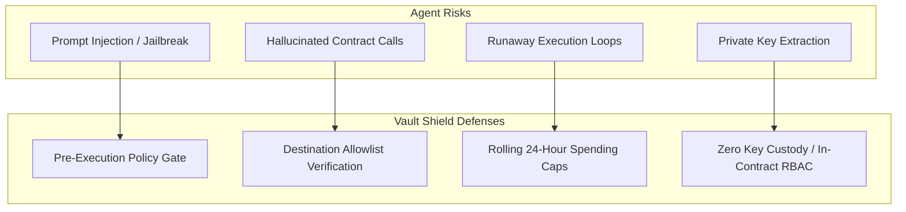

# Vault Shield — Security Architecture Specification

**Project**: Vault Shield — NEAR AI Agent Vault  
**Contract ID**: `contract.vault-parent.testnet`  
**Network**: NEAR Public Testnet  
**Frozen Source Commit**: `cc7760b`  
**Security Standard**: Non-Custodial Multi-Agent Policy Governance  

---

## 1. Threat Model & Autonomous Agent Vulnerabilities

Autonomous AI agents executing on-chain actions represent an emerging attack surface in decentralized systems. Vault Shield is engineered to counter the primary vectors of agent compromise:



1. **Prompt Injection & Misdirection**: Attackers inject adversarial text into LLM contexts instructing agents to transfer treasury funds to an attacker account.  
   *Defense*: Agent accounts hold no funds; they submit payment requests to Vault Shield, which verifies the destination against strict on-chain allowlists.
2. **Infinite API / Micro-Payment Loops**: Faulty agent planning logic triggers thousands of rapid-fire micro-transactions.  
   *Defense*: Rolling 24-hour spending buckets (`daily_cap`), per-transaction maximums (`max_per_transaction`), and dual-tier queue throttling (`MAX_AGENT_PENDING = 2`).
3. **Storage Eviction Attack (State Insolvency)**: Draining vault balance below NEAR's storage staking requirements ($10 \text{ NEAR / MB}$), causing the contract to be frozen or evicted.  
   *Defense*: Mathematical storage reserve locking calculated on every transaction.
4. **Indeterminate Asynchronous Failures**: Cross-contract promise failures leaving reserved funds locked in limbo.  
   *Defense*: Strict TTL expiration and owner cryptographic tombstone reconciliation.

---

## 2. Mathematical Solvency & Reservation Accounting

Vault Shield implements a zero-trust balance reservation ledger that guarantees that funds are committed before cross-contract promises are spawned.

```
Total Balance = Storage Reserve + Protected Balance
Protected Balance = Available Liquid + Pending Reserved + Inflight Reserved
```

### 2.1 The Solvency Invariant
At all times and across every execution path:
$$\text{Account Balance} \ge \text{Storage Reserve} + \text{Pending Reserved} + \text{Inflight Reserved}$$

$$\text{Available Liquid Balance} = \text{Account Balance} \dot{-} \text{Storage Reserve} \dot{-} \text{Pending Reserved} \dot{-} \text{Inflight Reserved}$$

Where $\dot{-}$ denotes saturating non-negative subtraction (`saturating_sub` in Rust).

### 2.2 Storage Reserve Isolation
The contract dynamically calculates the exact storage footprint occupied by all collections, state keys, and request objects:
$$\text{Storage Reserve (yocto)} = (\text{storage\_usage} + 10{,}000 \text{ bytes}) \times 10^{19} \text{ yoctoNEAR/byte}$$

- **Safety Buffer**: A permanent 10,000-byte margin is added to ensure that minor metadata additions never breach storage limits.
- **Unspendable Core**: Under no circumstances can owner withdrawals or agent payment dispatches access or spend this storage reserve.

### 2.3 Reservation Lifecycle
```mermaid
sequenceDiagram
    participant Agent
    participant Vault as Vault Contract
    participant Approvals as Pending Queue
    participant Target as Destination

    Agent->>Vault: request_payment(amount, dest)
    Vault->>Vault: Check Available Liquid >= amount
    alt Under Auto-Approval & Allowed
        Vault->>Vault: Move amount to Inflight Reserved
        Vault->>Target: Dispatch Transfer Promise
        Target-->>Vault: Promise Resolved
        Vault->>Vault: Deduct from Inflight, Record Spent
    else Requires Approval or Unlisted
        Vault->>Approvals: Push Request (ID, amount, TTL)
        Vault->>Vault: Move amount from Liquid to Pending Reserved
        Note over Vault,Approvals: Funds escrowed; cannot be double-spent
        Owner->>Vault: approve_request(ID)
        Vault->>Target: Dispatch Transfer Promise
    end
```

---

## 3. Two-Tier Queue Throttling Architecture

To prevent a compromised or misbehaving agent from consuming all available pending request slots, Vault Shield implements a two-tier queue limit in `src/accounting.rs`:

```rust
pub const MAX_GLOBAL_PENDING: u64 = 32; // Vault-wide limit across all agents
pub const MAX_AGENT_PENDING: u64 = 2;   // Individual agent concurrency ceiling
```

1. **Global Queue (`MAX_GLOBAL_PENDING = 32`)**: The maximum number of concurrent pending requests the contract can hold across all agents combined.
2. **Per-Agent Quota (`MAX_AGENT_PENDING = 2`)**: An individual agent can have at most 2 pending requests awaiting approval simultaneously. If an agent attempts to submit a 3rd request while 2 are pending, the contract immediately rejects the call with `AgentQueueLimitExceeded`.
3. **DoS Immunity**: Even if an agent generates rapid requests, other authorized agents retain guaranteed access to remaining queue slots.

---

## 4. Role-Based Access Control (RBAC) & Least Privilege

The contract strictly segments authority between three tiers of callers:

| Role / Caller | Permitted Invocations | Verification Macro |
| :--- | :--- | :--- |
| **Contract Owner** | `set_policy`, `add_destination`, `remove_destination`, `pause`, `unpause`, `withdraw`, `approve_request`, `reject_request`, `reconcile_stuck_request` | `assert_owner(&self)` |
| **Authorized Agent** | `request_payment` | `assert_agent_or_owner(&self)` |
| **Permissionless (Anyone)** | `expire_request`, all read views (`get_policy`, `get_request`, etc.) | None (Public) |

---

## 5. Defense-in-Depth & Operator Isolation

### 5.1 Zero-Custody Client-Side Signing
- Vault Shield never accepts, stores, or processes private keys or seed phrases on any server or API endpoint.
- All on-chain mutations initiated from the web interface sign exclusively in the user's browser via `@near-wallet-selector/core` and MyNearWallet / Meteor.

### 5.2 Serverless Edge Security (`/api/rpc` & `/api/tx/execute`)
1. **Sanitized RPC Proxy (`/api/rpc`)**:
   - Accepts only read/query methods (`query`, `status`, `block`).
   - Mutation methods (`broadcast_tx_commit`, `broadcast_tx_async`) are hard-rejected.
   - Restricts payload sizes to 64 KB.
   - Prevents arbitrary URL redirection; hardcoded to official NEAR Testnet RPC and FastNEAR failover.
2. **Production Execution Lockdown (`/api/tx/execute`)**:
   - Evaluates incoming execution requests in production and rejects simulated-persona executions with HTTP 403.
   - Prevents unauthorized server-side transaction broadcasting.

---

## 6. Audit Trail & Cryptographic Tombstones

1. **50-Slot Circular Audit Ring Buffer**:
   - Implemented via `AuditBuffer` in contract storage.
   - Records chronological security and governance events: `VaultPaused`, `VaultUnpaused`, `DestinationAdded`, `DestinationRemoved`, `AgentRegistered`, `AgentRevoked`, `PolicyUpdated`, and `PaymentPolicyDenied`.
   - Guaranteed bounded storage footprint; old events roll over without consuming unbounded state.
2. **Stuck Request Tombstone Reconciliation**:
   - In cross-contract failure scenarios where an external transaction cannot automatically complete, the owner invokes `reconcile_stuck_request` with an attested resolution (`AttestedResolution::Success` or `AttestedResolution::Refund`) and evidence transaction hash.
   - The contract records a permanent `ReconciledTombstone` in storage:
     - Guarantees that the reconciled request ID can never be re-executed or re-approved.
     - Releases pending reserved balance back to liquid funds.
     - Records an immutable cryptographic record of the owner's manual intervention.

