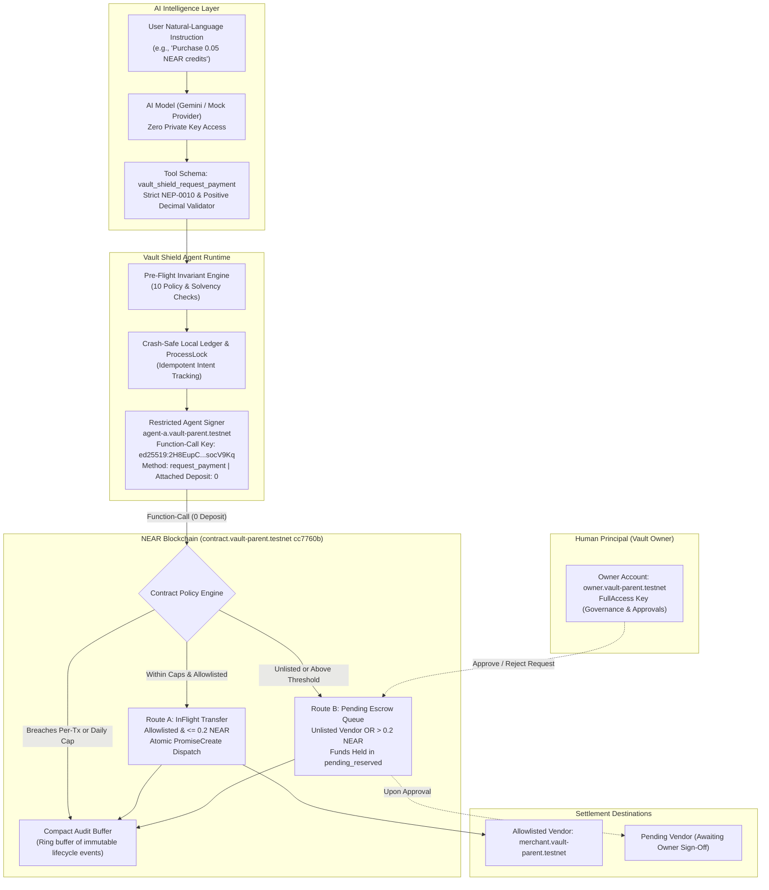

# Vault Shield — System Architecture
**Technical Specification & Cryptographic Confinement Model**

---

## 1. High-Level Architecture Diagram

---

## 2. Component Breakdown

### A. AI Intelligence Layer (`agent/src/llm.ts`)
- **Isolation Model**: The AI layer contains zero crypto signing capabilities, zero private keys, and zero direct network access to the contract.
- **Provider Abstraction**: Implements `LLMProvider` supporting:
  - `MockLLMProvider`: Deterministic offline provider for CI, automated testing, and reproducible scenario demonstrations.
  - `GeminiLLMProvider`: Native integration with Google Gemini models using native fetch, strictly isolated from payment execution.
- **Strict Tool Schema (`vault_shield_request_payment`)**:
  - `destination`: Validated against NEAR account naming specification (`NEP-0010`).
  - `amountNear`: Positive decimal string (e.g., `"0.05"`). Rejects non-numeric, negative, exponential, and units.
  - `reason`: Clean string bounded to 256 characters.
  - **Injection Defense**: Unexpected arguments are rejected immediately; schema violations abort execution before reaching pre-flight.

### B. Agent Runtime & Pre-Flight Engine (`agent/src/agent.ts`, `preflight.ts`, `signer.ts`, `ledger.ts`)
- **Client-Side Pre-Flight Invariant Engine**: Before any transaction payload is prepared, the runtime evaluates 10 invariant conditions against on-chain contract view state:
  1. `Valid Destination Account ID`: Syntax matches `NEP-0010`.
  2. `Positive Transfer Amount`: Parsed yoctoNEAR $> 0$.
  3. `Agent Authorization Status`: Signer is present in `authorized_agents`.
  4. `Vault Emergency Pause Status`: Contract and policy `is_paused == false`.
  5. `Per-Transaction Cap Compliance`: $\text{amount} \le \text{max\_per\_transaction}$ ($1.0\text{ NEAR}$).
  6. `Daily Cap & Budget Compliance`: $\text{spent} + \text{reserved} + \text{amount} \le \text{daily\_cap}$ ($2.0\text{ NEAR}$).
  7. `Available Liquid Balance Solvency`: $\text{amount} \le \text{available\_liquid\_balance}$.
  8. `Queue Limits`: Agent queue $< 2$ active slots, global queue $< 32$ active slots.
  9. `Destination Allowlist`: Checked for Route A eligibility.
  10. `Auto-Approval Threshold`: $\text{amount} \le \text{auto\_approval\_threshold}$ ($0.2\text{ NEAR}$).
- **Idempotency & Concurrency**:
  - `ProcessLock`: Filesystem lockfile with PID tracking and stale-lock recovery ($> 900\text{s}$) prevents concurrent execution conflicts.
  - `Ledger`: Atomic JSON ledger writes using `.tmp` file renaming prevent state corruption during abrupt process termination. Duplicate intents are rejected automatically.

### C. Cryptographic Signer & Confinement (`agent/src/signer.ts`)
- **Key Type**: NEAR Function-Call Access Key (`ed25519:2H8EupC...socV9Kq`).
- **Target Method**: Strictly restricted to `request_payment`.
- **Attached Deposit**: Must be exactly `0 yoctoNEAR`. Any non-zero attached deposit is rejected locally and rejected on-chain by the key permissions.
- **Gas Limit**: Bounded to $30\text{ TGas}$.
- **Zero Custody**: The agent account (`agent-a.vault-parent.testnet`) never holds custody of vault tokens; funds move atomically from the contract balance directly to the recipient.
- **Separation of Concerns**: The restricted key has zero authority to invoke governance methods: `add_agent`, `revoke_agent`, `set_policy`, `withdraw`, `pause`, or `unpause`.

### D. On-Chain Smart Contract (`src/lib.rs` frozen at `cc7760b`)
- **Sovereign Non-Custodial Vault**: Deployed on NEAR Testnet at `contract.vault-parent.testnet`.
- **Solvency Accounting Equation**:
  $$\text{Total Account Balance} = \text{Storage Reserve Requirement} + \text{Protected Balance} + \text{Pending Reserved} + \text{InFlight Reserved} + \text{Available Liquid Balance}$$
- **Two-Phase Commit Model**:
  - **Route A (InFlight)**: If allowlisted AND within auto threshold, funds move from `available_liquid_balance` to `inflight_reserved` and dispatch via `PromiseCreate::transfer()`.
  - **Route B (Pending)**: If unlisted or above threshold, funds move to `pending_reserved` escrow until the Owner signs `approve_request()` or `reject_request()`.
- **Compact Audit Trail**: Ring buffer of the last 50 lifecycle events stored directly in contract state for verifiable transparency.

### E. Frontend AI Agent Cockpit (`frontend/src/`)
- Pure React 19 + TypeScript + Vite client-side SPA.
- Reads contract state via direct JSON-RPC queries to NEAR Testnet (`nearRpc.ts`).
- Provides client-side execution simulation of all 3 canonical policy scenarios (`agentHarness.ts`).
- Clearly differentiates between **Client-Side Pre-Flight Invariant Evaluation**, **Predicted Policy Routing**, **Dry-Run Simulation**, and **Verified Historical On-Chain Settlement**.
